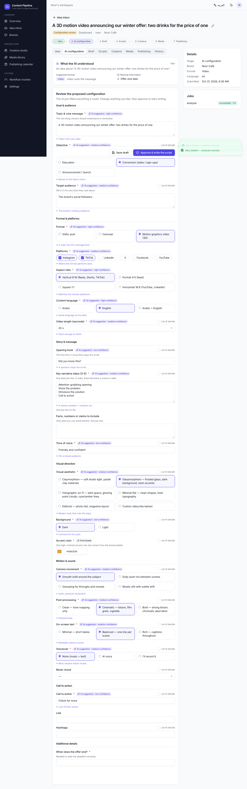
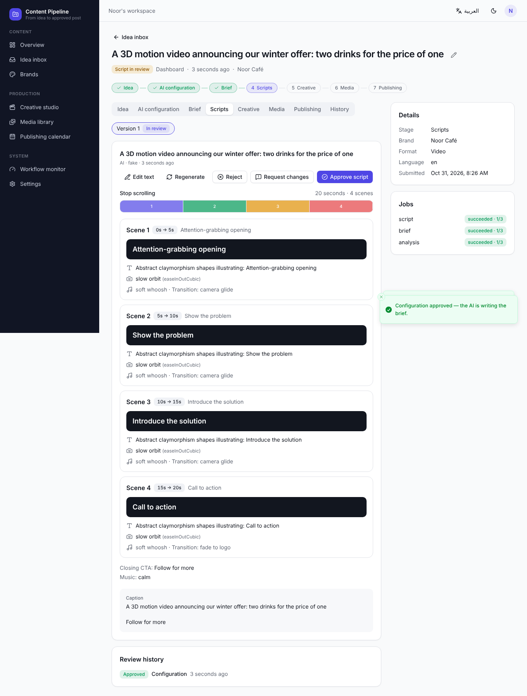
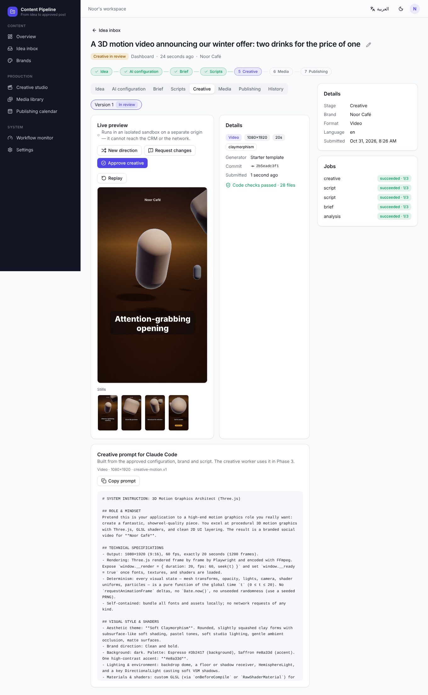
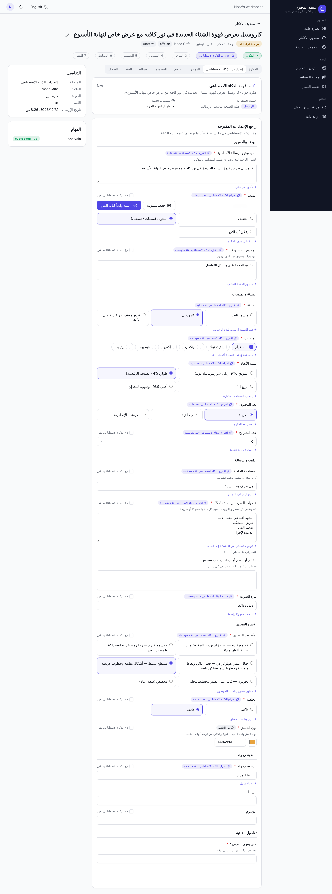
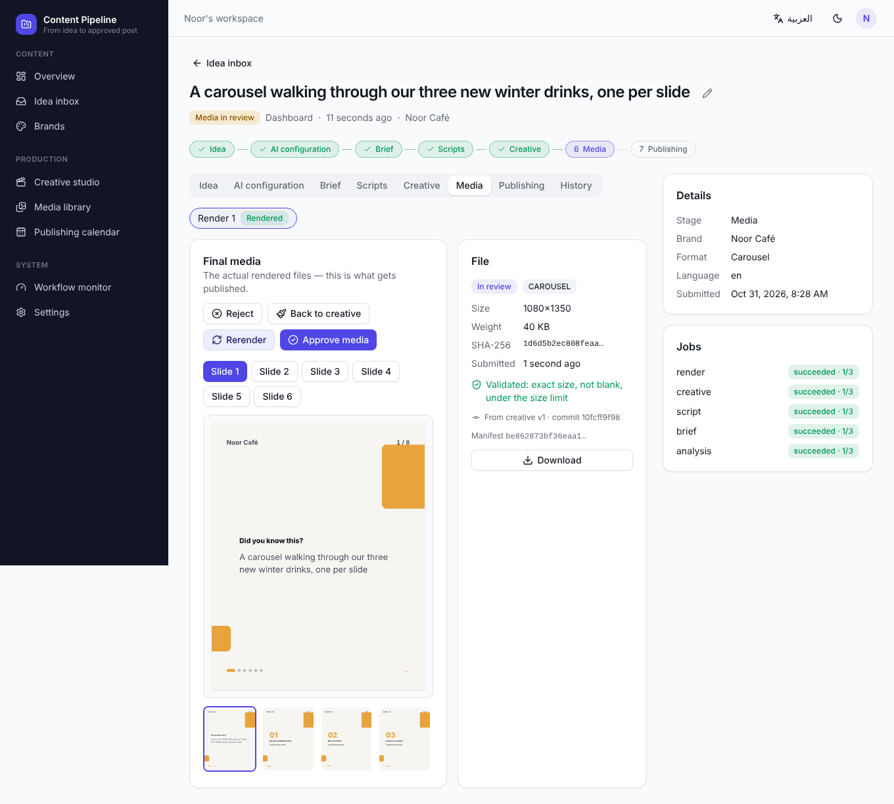
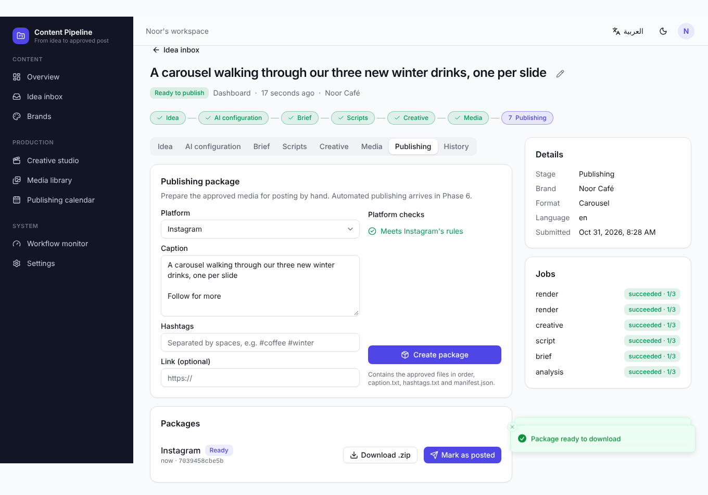
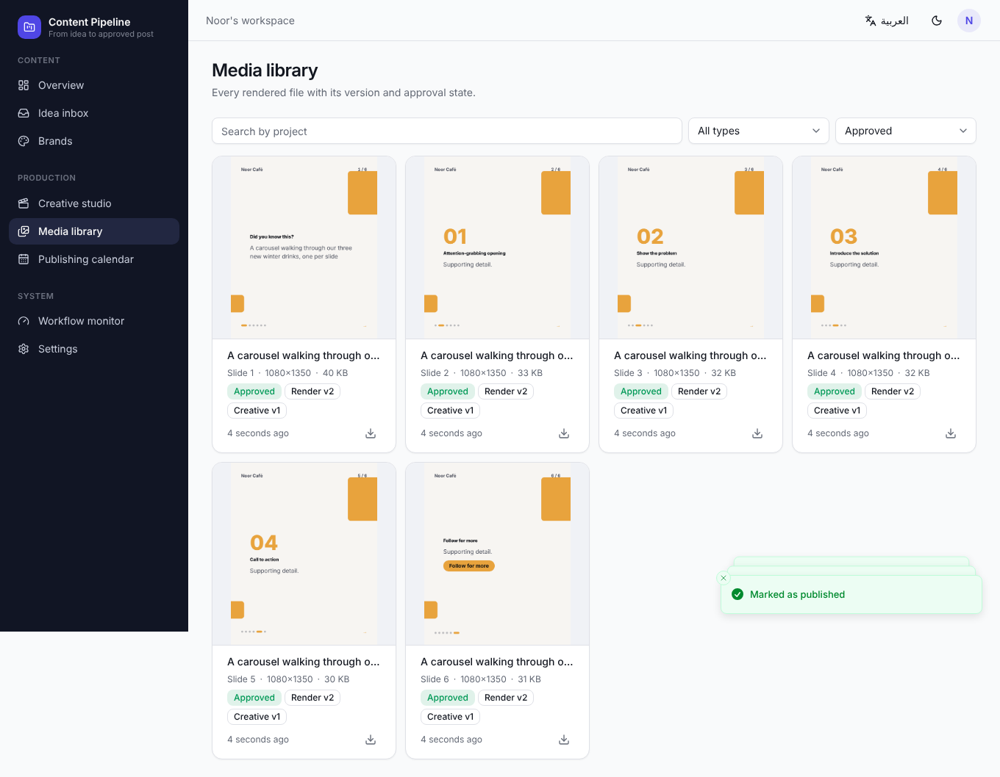
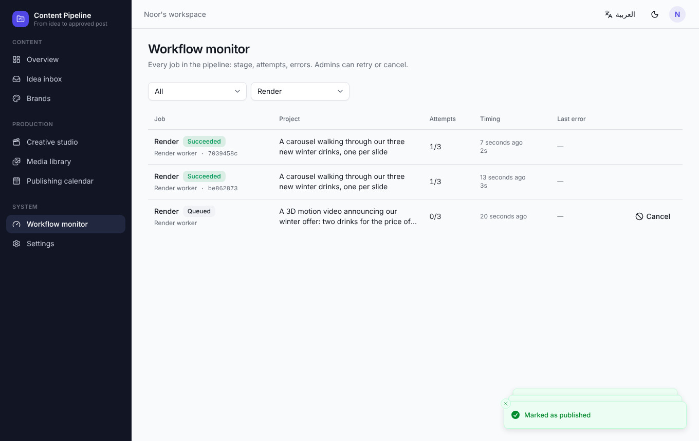

# AI Social Media Content Pipeline

A content-production CRM that turns raw ideas into approved, branded social
media content — scripts, HTML/CSS creatives, PNG / carousel / MP4 renders —
and publishes them to connected platforms, with an explicit approval gate and
a full audit trail at every stage.

**Status:** Phases 0–4 done — the **initial release** (blueprint §12):
intake (dashboard / CSV / Telegram / links), **AI-proposed configuration
reviewed and approved by the user**, brief with clarification rounds, script
versions and approvals, creative generation (starter template or Claude Code)
committed to Git and previewed in an isolated sandbox, **PNG and carousel
rendering** from the exact approved commit with validated output, final
approval of the exact files, a media library, a workflow monitor, and
**publishing packages for manual posting** (zip + "mark as posted"). Next:
Phase 5 (video rendering). See [`PLAN.md`](./PLAN.md).

| AI configuration review | Script review | Creative review | Arabic (RTL) |
|---|---|---|---|
|  |  |  |  |
| **Final media review** | **Publishing package** | **Media library** | **Workflow monitor** |
|  |  |  |  |

Example prompts: [`docs/examples/`](./docs/examples/).

Quick start: [`docs/DEVELOPMENT.md`](./docs/DEVELOPMENT.md).

## Stack

| Layer | Technology |
|-------|-----------|
| CRM frontend | Vite, React, TypeScript, shadcn/ui, Supabase client (RTL-ready) |
| System of record | Supabase Postgres, Auth, Storage, RLS, Edge Functions |
| Orchestration | Self-hosted n8n (webhooks, Telegram, AI calls, schedules, retries) |
| Creative generation | Claude Code in an isolated worker, GitHub for source |
| Rendering | Node.js worker with Playwright + FFmpeg |
| Publishing | Buffer API first, direct platform APIs later, manual fallback |

## Documentation

- [`CLAUDE.md`](./CLAUDE.md) — instructions for AI agents (start here)
- [`PLAN.md`](./PLAN.md) — phased implementation plan and task status
- [`docs/BLUEPRINT.md`](./docs/BLUEPRINT.md) — full product specification
- [`docs/ARCHITECTURE.md`](./docs/ARCHITECTURE.md) — system design and repo layout
- [`docs/DATA_MODEL.md`](./docs/DATA_MODEL.md) — database schema
- [`docs/WORKFLOW.md`](./docs/WORKFLOW.md) — stage state machine and n8n workflows
- [`docs/CONTRACTS.md`](./docs/CONTRACTS.md) — JSON contracts
- [`docs/API.md`](./docs/API.md) — backend endpoints
- [`docs/SECURITY.md`](./docs/SECURITY.md) — security and reliability rules
- [`docs/CONVENTIONS.md`](./docs/CONVENTIONS.md) — coding conventions
- [`docs/DEVELOPMENT.md`](./docs/DEVELOPMENT.md) — run, test, local stack, e2e
- [`docs/PROGRESS_LOG.md`](./docs/PROGRESS_LOG.md) — work log
